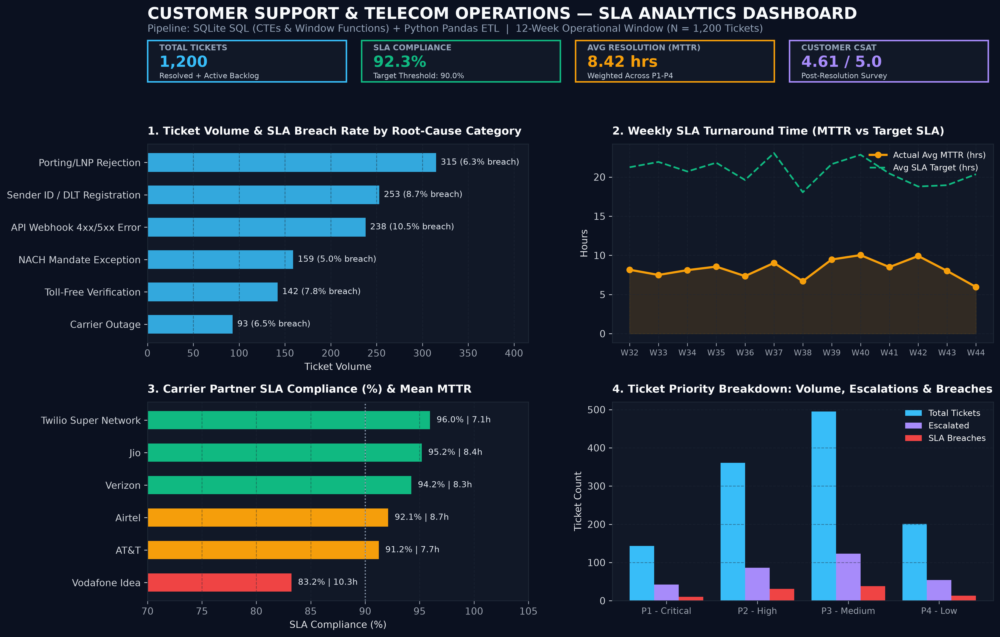

# Customer Support & SLA Analytics Dashboard (SQL + Python + Looker Studio / Tableau)

An end-to-end **Customer & Carrier Operations Analytics Pipeline** built with **SQLite SQL**, **Python (`pandas`, `numpy`, `matplotlib`)**, and **Looker Studio / Tableau Public-ready outputs**. Designed to monitor support ticket volume, root-cause Pareto breakdowns, carrier partner turnaround times (FRT & MTTR), and SLA breach hotspots across telecom and financial operations workflows.

---

## Key Capabilities & Tech Stack

- **SQL (`sql/sla_analytics_queries.sql`)**: Multi-table `JOIN`s, Common Table Expressions (`WITH`), `CASE WHEN` conditional aggregations, and SQL window functions (`RANK() OVER`, cumulative `SUM() OVER`).
- **Python ETL (`src/etl_sla_pipeline.py`)**: Cleans and transforms 1,200 support tickets (`support_tickets_raw.csv` + `carriers_reference.csv`), persists to `support_ops.db` (SQLite), executes production SQL queries, and exports BI-ready summary datasets.
- **BI Visualization (`screenshots/sla_analytics_dashboard.png` & `dashboard/index.html`)**:
  - **KPI Summary**: Total Tickets, Overall SLA Compliance %, Mean Time to Resolution (MTTR), and Customer CSAT.
  - **Root-Cause Pareto**: Volume & breach concentration across `Porting/LNP Rejection`, `Sender ID / DLT Registration`, `API Webhook 4xx/5xx Error`, `NACH Mandate Exception`, `Toll-Free Verification`, and `Carrier Outage`.
  - **Carrier Partner SLA Scorecard**: Benchmarking Airtel, Jio, Vodafone Idea, AT&T, Verizon, and Twilio Super Network.
  - **Repeat Escalation Watchlist**: Flagging high-touch accounts exceeding 2 SLA breaches.

---

## Database Schema

```
carriers_reference                    support_tickets
+--------------------------+          +------------------------------+
| carrier_id (PK)          |<----+    | ticket_id (PK)               |
| carrier_name             |     |    | account_id / account_name    |
| region                   |     +----| carrier_id (FK)              |
| partner_tier             |          | created_at / resolved_at     |
| target_carrier_sla_hours |          | priority / issue_category    |
+--------------------------+          | first_response_minutes       |
                                      | resolution_hours             |
                                      | sla_breached_flag / csat     |
                                      +------------------------------+
```

---

## Dashboard Preview



---

## Project Structure

```
01-customer-support-sla-dashboard/
├── data/
│   ├── carriers_reference.csv
│   ├── support_tickets_raw.csv
│   └── support_ops.db
├── sql/
│   └── sla_analytics_queries.sql
├── src/
│   └── etl_sla_pipeline.py
├── output/
│   ├── tickets_enriched_for_bi.csv
│   ├── kpi_summary_by_category.csv
│   ├── carrier_sla_performance.csv
│   ├── root_cause_pareto.csv
│   ├── weekly_ticket_trends.csv
│   └── high_touch_repeat_accounts.csv
├── dashboard/
│   └── index.html
└── screenshots/
    └── sla_analytics_dashboard.png
```

---

## How to Run Locally

```bash
pip install pandas numpy matplotlib
python src/etl_sla_pipeline.py
```

1. Open `dashboard/index.html` in any browser for an interactive Looker Studio-style view.
2. Upload `output/tickets_enriched_for_bi.csv` directly into **Google Looker Studio** or **Tableau Public** to publish an interactive web dashboard link.
